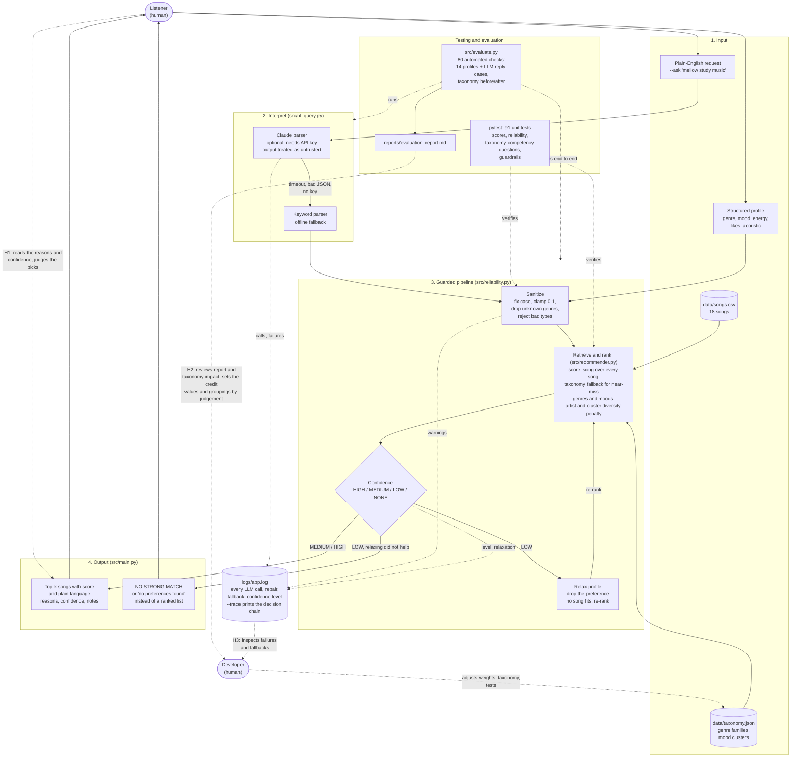

# VibeScorecard: a music recommender that knows when it can't help

> **Original project:** *Music Recommender Simulation* (VibeScorecard 1.0, the state of this repo at commit `dda26d2`, before the work described below). That version was a small, explainable content-based recommender: it loaded 18 songs from a CSV, scored each one against a listener's stated genre, mood, energy and acoustic preference with a weighted point recipe, and printed the top five with a plain-language list of the points each song earned. It also had four scoring modes, partial credit for related moods and genres, an artist-diversity penalty, a handful of unit tests and a model card. Its main weakness, which this project addresses, was that it gave confident-looking lists even when nothing in the catalog fit the listener.

## What this project is, and why it matters

VibeScorecard 2.0 takes that recommender and wraps it in a **reliability and testing system**, so it can say *how much to trust its own answer*. Every request goes through input repair, a confidence rating, and (when the match is weak) an automatic relaxation step; if nothing fits, it says so instead of printing a ranked list that looks like a recommendation. You can also ask in plain English (`--ask "mellow music for studying"`), where Claude optionally translates the sentence into preferences while the deterministic scorer still does all the ranking.

It matters because the failure that makes AI systems risky is rarely a crash. It is a confident answer that is quietly wrong. This project is a small, fully inspectable example of designing against that: guardrails, logging, measured evaluation, and honest documentation of what the system cannot do.

| Capability | Where |
|---|---|
| Explainable weighted scorer with four modes | `src/recommender.py` |
| Genre/mood taxonomy that scores near-miss labels | `data/taxonomy.json`, `src/taxonomy.py` |
| Reliability layer: sanitize, confidence, relax, no-match | `src/reliability.py` |
| Optional Claude natural-language front end with offline fallback | `src/nl_query.py` |
| Optional embedding parser for paraphrased requests (`--embeddings`) | `src/embed_parse.py` |
| Taxonomy cross-check against the NRC-VAD word-rating lexicon | `src/lexicon_check.py` |
| Evaluation harness (80 checks) and unit tests (91) | `src/evaluate.py`, `tests/` |
| Logging to `logs/app.log` | `src/main.py` |

## Results at a glance

| What was measured | Result | Where to look |
|---|---|---|
| Unit tests | 91 of 91 pass | `python -m pytest` |
| Evaluation checks (14 profiles plus 13 request-parsing cases) | 80 of 80 pass | `python -m src.evaluate`, table A and B below |
| Confidence across the 13 scored profiles | 7 HIGH, 5 MEDIUM, 0 LOW, 1 NONE; mean top score 0.87 | table C below |
| Diversity step on vs off | catalog coverage 94% to 100%; share of list slots taken by the 5 most-shown songs 55% to 48% | table D below |
| Taxonomy vs NRC-VAD word ratings | cluster tags agree on both axes; moods in one cluster are closer (0.79) than moods in different clusters (1.21); rank correlation +0.76 for valence and +0.81 for arousal | lexicon cross-check below |
| Request parsing, held-out half of the benchmark | keywords 67%, embeddings alone 50%, hybrid (optional `--embeddings`) 83% | parser benchmark below |
| Not measured | listener satisfaction or recommendation accuracy (there are no listener ratings); the live Claude path | limitations in the [model card](model_card.md) |

## Stretch features

| Stretch feature | Status | Evidence |
|---|---|---|
| Test harness / evaluation script | Built | `python -m src.evaluate` runs 80 checks, prints pass/fail and confidence ratings, writes `reports/evaluation_report.md`, and exits non-zero on failure (see "Testing summary"). |
| Agentic workflow enhancement | Built | The pipeline is a multi-step decision chain (sanitize, rank, rate confidence, relax and re-rank, or refuse). Every step records what it saw and decided; `python -m src.main --trace` prints it, [docs/agent_traces.md](docs/agent_traces.md) holds six real traces, and [ai_interactions.md](ai_interactions.md) embeds them. It is deterministic rules, not an LLM planning or calling tools. |
| Fine-tuning or specialization | Built, in a limited sense | The optional hybrid parser is specialized with exemplar phrases per mood and thresholds tuned on a labelled set. No model weights are trained. Its output measurably differs from the baseline (table below). |
| RAG enhancement | Not attempted | Scoring retrieves from `songs.csv` and `taxonomy.json`, but no retrieved text conditions generated output, so I do not claim RAG. |

### Specialization: measured difference from the baseline

The baseline is the keyword parser; the specialized parser is the hybrid (rules first, embedding prototypes fill gaps). Of the 36 benchmark requests, their outputs differ on 18; the specialized parser fixes 9 and breaks none. A sample, including two it still gets wrong (full list in `reports/parser_benchmark.md`):

| Request | Baseline output | Specialized output | Baseline | Specialized |
|---|---|---|---|---|
| music to unwind after a long day | `{}` | `{"mood": "relaxed", "energy": 0.15}` | wrong | right |
| songs that make me want to dance all night | `{"energy": 0.85}` | `{"mood": "euphoric", "energy": 0.85}` | wrong | right |
| I'm heartbroken | `{}` | `{"mood": "sad"}` | wrong | right |
| wistful memories of my childhood | `{}` | `{"mood": "nostalgic"}` | wrong | right |
| fast and loud | `{}` | `{"mood": "intense", "energy": 0.93}` | wrong | right |
| feel-good summer vibes | `{}` | `{"mood": "chill", "energy": 0.8}` | wrong | wrong |
| slow and gentle | `{}` | `{"mood": "romantic", "energy": 0.3}` | wrong | wrong |

## Architecture overview

Source: [diagrams/architecture.mmd](diagrams/architecture.mmd). Solid arrows are data flow; dotted arrows are checking and feedback.



**Reading the diagram.** *Input* is either a structured profile or a plain-English request, plus the song catalog and the taxonomy. *Interpret* turns text into preferences: Claude when an API key is set, otherwise a keyword parser, and any Claude failure (timeout, bad JSON, no key) drops to the keyword parser. The *guarded pipeline* sanitizes the preferences, ranks every song (the "retriever"), and rates confidence; a LOW rating triggers a relax-and-re-rank loop, and if that does not help the user sees NO STRONG MATCH. *Testing* is the unit tests plus the evaluator, which runs the whole pipeline over 14 profiles and LLM-reply cases. Humans check the AI at three points: **H1** the listener reads the reasons and confidence and judges the picks, **H2** the developer reviews the evaluation report and decides the taxonomy groupings and credit values, **H3** the developer inspects the log for failures and fallbacks.

## Setup instructions

Requires **Python 3.11 or newer** (developed on 3.14) and internet access for the one-time install. Run every command from the project root.

```bash
# 1. Get the code
git clone <this repository's URL>
cd applied-ai-system-project

# 2. Create and activate a virtual environment
python -m venv .venv
source .venv/bin/activate          # Mac or Linux
.venv\Scripts\activate             # Windows (cmd or PowerShell)

# 3. Install the pinned dependencies (anthropic, pytest)
pip install -r requirements.txt

# 4. Check that everything works
python -m pytest                   # expect: 91 passed
python -m src.evaluate             # expect: Total: 80/80 checks passed.

# 5. Run it
python -m src.main                                    # the 14 built-in listener profiles
python -m src.main --ask "mellow music for studying"  # plain-English request
python -m src.main --mode mood-first                  # another scoring mode
python -m src.main --compare                          # top 3 under every mode
```

**Optional: Claude-powered `--ask`.** Everything above works with no API key. To let Claude interpret requests, set `ANTHROPIC_API_KEY` (from the Anthropic console) before running. The output then says `Interpreted via: llm`; without a key it says `keywords`.

```bash
export ANTHROPIC_API_KEY=sk-ant-...        # Mac or Linux
$env:ANTHROPIC_API_KEY = "sk-ant-..."      # Windows PowerShell
```

**Optional: embedding parser (`--embeddings`).** Without an API key, `--ask` falls back to keyword rules, which miss paraphrases such as "music to unwind after a long day". An optional sentence-embedding model fills those gaps while the rules still handle goals and negation. It is off by default because it adds about 1.2 GB of packages (PyTorch) and a ~175 MB model download on first use, so the standard install stays small:

```bash
pip install -r requirements-embeddings.txt
python -m src.main --ask "music to unwind after a long day" --embeddings   # output says: Interpreted via: embeddings+keywords
python -m src.benchmark_parsers                                            # compares the parsers, writes reports/parser_benchmark.md
```

If the package or model is unavailable, the flag prints a note and the keyword fallback runs, so nothing breaks.

**Optional: taxonomy cross-check.** `python -m src.lexicon_check` compares the mood taxonomy with the NRC-VAD word-rating lexicon. The lexicon is not included (its terms forbid redistribution): download v2.1 from the [NRC page](https://saifmohammad.com/WebPages/nrc-vad.html), unzip it into `data/external/` (git-ignored), and run the command. It is free for non-commercial research and education.

**Troubleshooting.** If `uv` fails with "failed to hardlink" because the project is in a OneDrive or Dropbox folder, set `UV_LINK_MODE=copy` first. If the catalog file is missing or malformed, the app stops with a one-line message and exit code 1. Logs go to `logs/app.log`; only warnings and errors also appear in the terminal.

## Sample interactions

These are real outputs from the current code (long lists trimmed to the top entries; "..." marks the cut).

**1. Plain-English request, no API key (keyword fallback).** `python -m src.main --ask "mellow music for studying"`

```
================================================================
    TOP RECOMMENDATIONS: Request: mellow music for studying     
================================================================
Profile: mood=chill, energy=0.3

1. Spacewalk Thoughts by Orbit Bloom
   Score: 0.98 / 1.00   [ambient | chill]
   Why:
     - energy 0.28 vs target 0.30 (+3.36)
     - mood matches (chill) (+3.00)

2. Library Rain by Paper Lanterns
   Score: 0.95 / 1.00   [lofi | chill]
   Why:
     - energy 0.35 vs target 0.30 (+3.15)
     - mood matches (chill) (+3.00)

   ... (3 more)

----------------------------------------------------------------
Confidence: HIGH (top score 0.98)
Interpreted via: keywords
  note: no ANTHROPIC_API_KEY; used keyword fallback
```

The sentence became `mood=chill, energy=0.3`. The "Why" lines show exactly how each score was earned.

**2. A normal listener profile.** A rock fan who wants intense, high-energy, non-acoustic music.

```
================================================================
             TOP RECOMMENDATIONS: Deep Intense Rock             
================================================================
Profile: genre=rock, mood=intense, energy=0.92, likes_acoustic=False

1. Storm Runner by Voltline
   Score: 0.95 / 1.00   [rock | intense]
   Why:
     - energy 0.91 vs target 0.92 (+3.43)
     - mood matches (intense) (+3.00)
     - acousticness 0.10 vs target 0.20 (+1.60)
     - genre matches (rock) (+1.50)

2. Iron Tide by Black Anvil
   Score: 0.80 / 1.00   [metal | aggressive]
   Why:
     - energy 0.97 vs target 0.92 (+3.15)
     - mood is close (aggressive) (+2.70)
     - acousticness 0.04 vs target 0.20 (+1.36)
     - genre is close (metal) (+0.75)

   ... (3 more)

----------------------------------------------------------------
Confidence: HIGH (top score 0.95)
```

Note song 2: a metal track earns 90% of the mood points ("aggressive" is close to "intense") and half the genre points through the rock/metal relationship. That is the graded-similarity design working as intended.

**3. A contradictory profile: the system should hedge, and does only partly.** A metal fan who asks for a *chill* mood at energy 0.97.

```
================================================================
  TOP RECOMMENDATIONS: Adversarial: metal fan who wants chill   
================================================================
Profile: genre=metal, mood=chill, energy=0.97, likes_acoustic=False

1. Iron Tide by Black Anvil
   Score: 0.64 / 1.00   [metal | aggressive]
   Why:
     - energy 0.97 vs target 0.97 (+3.50)
     - mood differs (aggressive) (+0.00)
     - acousticness 0.04 vs target 0.20 (+1.36)
     - genre matches (metal) (+1.50)

   ... (4 more)

----------------------------------------------------------------
Confidence: MEDIUM (top score 0.64)
  note: best match scored only 0.64
```

No song is both chill and extremely loud, so the best match earns zero mood points. The confidence drops to MEDIUM and a note is added, but the system does not say *why* (that the mood and energy contradict each other). This is a known limitation, listed in the model card.

**4. A request the system cannot interpret.** `python -m src.main --ask "asdf qwerty"`

```
Could not find any music preferences in that request.
  note: no ANTHROPIC_API_KEY; used keyword fallback
Try something like: --ask "upbeat pop for a workout"
```

Instead of printing an arbitrary ranking, it says it found nothing usable. (An earlier version printed a list anyway.)

More outputs: all 14 profiles are in [docs/scoring_details.md](docs/scoring_details.md), and the latest automated results are in [reports/evaluation_report.md](reports/evaluation_report.md). The live Claude path has not been run in my own testing; it is exercised offline with a fake client (see Testing).

## Design decisions and trade-offs

- **The LLM translates; the scorer decides.** Claude only turns a sentence into a preferences dictionary. A deterministic scorer does every ranking, so each pick stays explainable, repeatable and testable, and an LLM failure cannot change the ranking logic. *Trade-off:* the LLM cannot improve the ranking, and the offline keyword fallback is crude (it ignores genre words, skips negated words such as "not sad" rather than reading their opposite, and knows only a few goal phrases such as "cheer me up").
- **Embeddings as a gap-filler, opt-in.** On a 36-request hand-labelled benchmark, keyword rules alone scored 67% on the held-out half, embeddings alone 50%, and the hybrid (rules first, embeddings fill gaps, embedding moods dropped when the request contains a negator) 83%. Embeddings alone were worse than the rules because they cannot read goals or negation ("cheer me up" lands near sad). The thresholds were tuned on the other half. *Trade-offs:* about 1.2 GB of dependencies and a one-time ~5 s model load (about 6 ms per request after that), so it is off by default; the benchmark is small, was drafted by Claude Code before any model ran, has one set of labels, and is weighted toward paraphrases (14 of 36 requests), which the keyword rules were never built for; and it measures parsing, not whether listeners get better recommendations.
- **Read the wanted state, not the stated one.** Surveys of why people listen find that mood and arousal regulation is the most common reason (Schäfer et al., 2013), so a request like "I'm sad, cheer me up" asks for happy music. Both the Claude prompt and the keyword fallback treat goal phrases as the target state. *Trade-off:* the fallback only knows a handful of phrases, and a listener who really wants music that matches a sad mood ("I'm sad, play something sad") is handled correctly only because there is no goal phrase to override it.
- **Treat model output as untrusted.** Replies are parsed as JSON, restricted to five known keys, clamped, and checked against the catalog's real genres and moods, so a hallucinated "vaporwave" is dropped. Calls have a 20 s timeout and one retry. *Trade-off:* a good answer outside the whitelist is also discarded.
- **A hand-weighted scorecard, not a learned model.** There is no listening data to train on, and explainability was a goal. *Trade-off:* every weight and credit is a judgement call, and one (intense/aggressive at 0.9) was tuned to a single test case.
- **Mood outweighs genre.** Most genres have one song in this catalog, so a heavy genre weight would pin results to that one track. *Trade-off:* a same-genre song with the wrong feel can lose.
- **Taxonomy as a fallback, not a replacement.** The hand-tuned similarity tables keep their exact values; the taxonomy only fills in pairs they do not list. This changed the top five for 8 of 14 profiles, which is why it is measured and reported rather than assumed good. I chose a small JSON file plus a loader over a formal ontology (RDF/OWL): the catalog has no notes or chords for an ontology to reason about, so it would have been machinery without payoff. I did borrow one idea from the ontology literature, testing with "competency questions". *Trade-off:* the groupings and credit values are judgement calls, checked against the catalog data but not against listeners.
- **Degrade where safe, stop where not.** A bad Claude reply or a corrupt taxonomy file falls back and logs; a missing or malformed song catalog stops with a clear message, because there is nothing correct to fall back to.
- **Honest confidence over confident answers.** A LOW rating relaxes the profile (drops the preference nothing fits) and re-ranks; if that does not help, it prints NO STRONG MATCH. *Trade-off:* the confidence thresholds are hand-set, and the system sometimes gives a MEDIUM rating to a contradictory request (sample 3).

## Testing summary

**Summary.** 91 of 91 unit tests and 80 of 80 evaluation checks pass. Across the 13 profiles the scorer accepts, confidence was 7 HIGH, 5 MEDIUM, 0 LOW and 1 NONE, with a mean top score of 0.87 (lowest 0.62). The system struggled when context was missing or contradictory: an empty profile gets confidence NONE, and a contradictory one (a metal fan asking for "chill") still earns MEDIUM instead of being flagged. Validation rules removed every crash the original version had (`likes_acoustic="maybe"`, `energy="high"`), and the diversity step raised catalog coverage from 94% to 100% and cut the share of list slots taken by the five most-shown songs from 55% to 48%.

### How reliability is tested

| Method | Where | Result |
|---|---|---|
| Automated unit tests | `tests/` (`python -m pytest`) | 91 passed |
| Evaluation harness: property checks on 14 profiles and 13 request-parsing cases | `src/evaluate.py` | 80 of 80 passed |
| Confidence scoring (HIGH / MEDIUM / LOW / NONE from the best score) | `src/reliability.py` | see table C |
| Logging and error handling | `logs/app.log`; `tests/test_guardrails.py` | every LLM call, repair, fallback and confidence level is logged; bad catalog, bad taxonomy, blank or oversized requests handled |
| Beyond-accuracy metrics (diversity, coverage, exposure) | `src/metrics.py`, `src/evaluate.py` | see table D |
| Decision trace (`--trace`, `docs/agent_traces.md`) | `src/reliability.py`, `src/traces.py` | every step of the chain is recorded and tested |
| Request-parser benchmark (keywords vs embeddings vs hybrid, 36 labelled requests) | `data/nl_benchmark.json`, `src/benchmark_parsers.py` | see the parser benchmark below |
| Taxonomy cross-check against the NRC-VAD lexicon | `src/lexicon_check.py` | see the lexicon check below |
| Human evaluation | none done | no peer or listener review has been done; every result here is automated |

### Results (generated by `python -m src.evaluate`, copied from `reports/evaluation_report.md`)

**A. Profile checks.** Each profile is checked for: k results returned, scores within 0 to 1, no artist more than twice, deterministic ranking, and the expected confidence level (or a clean rejection of invalid input).

| Test input (profile) | Evaluation criteria | Expected confidence | Actual confidence (top score) | Checks passed | Result |
|---|---|---|---|---|---|
| High-Energy Pop | 5 properties + confidence | HIGH | HIGH (0.97) | 5 of 5 | Pass |
| Chill Lofi | 5 properties + confidence | HIGH | HIGH (0.98) | 5 of 5 | Pass |
| Deep Intense Rock | 5 properties + confidence | HIGH | HIGH (0.95) | 5 of 5 | Pass |
| Conflicted (sad but high-energy) | 5 properties + confidence | LOW/MEDIUM | MEDIUM (0.62) | 5 of 5 | Pass |
| Adversarial: metal fan who wants chill | 5 properties + confidence | LOW/MEDIUM | MEDIUM (0.64) | 5 of 5 | Pass |
| Adversarial: acoustic-loving EDM fan | 5 properties + confidence | LOW/MEDIUM | MEDIUM (0.80) | 5 of 5 | Pass |
| Adversarial: empty profile | 5 properties + confidence | NONE | NONE (0.00) | 5 of 5 | Pass |
| Adversarial: wrong-case genre and mood | 5 properties + confidence | HIGH/LOW/MEDIUM | HIGH (0.98) | 5 of 5 | Pass |
| Adversarial: likes_acoustic='no' | 5 properties + confidence | HIGH | HIGH (0.95) | 5 of 5 | Pass |
| Adversarial: likes_acoustic='maybe' | 5 properties + confidence | NONE | rejected cleanly | 2 of 2 | Pass |
| Numeric acousticness=0.5 | 5 properties + confidence | HIGH/LOW/MEDIUM | MEDIUM (0.75) | 5 of 5 | Pass |
| Adversarial: genre-only (lofi) | 5 properties + confidence | MEDIUM | MEDIUM (1.00) | 5 of 5 | Pass |
| Adversarial: energy out of range (1.5) | 5 properties + confidence | HIGH/LOW/MEDIUM | HIGH (0.87) | 5 of 5 | Pass |
| Adversarial: energy='high' (wrong type) | 5 properties + confidence | HIGH/LOW/MEDIUM | HIGH (0.99) | 5 of 5 | Pass |

**B. Request-parsing cases.** `x` is a placeholder request; the reply comes from an offline fake Claude client so the test needs no key.

| Case | Input | Parsed preferences | Source | Result |
|---|---|---|---|---|
| keywords: study music | `something mellow for studying` | `{"mood": "chill", "energy": 0.3}` | keywords | Pass |
| keywords: workout | `pump-up music for the gym` | `{"energy": 0.9}` | keywords | Pass |
| keywords: gibberish | `asdf qwerty` | `{}` | keywords | Pass |
| keywords: goal beats current mood | `I'm sad, cheer me up` | `{"mood": "happy"}` | keywords | Pass |
| keywords: wake-me-up goal | `wake me up` | `{"energy": 0.85}` | keywords | Pass |
| keywords: negation skipped | `I am not sad` | `{}` | keywords | Pass |
| keywords: word not substring | `brunch playlist` | `{}` | keywords | Pass |
| llm: well-formed JSON | `x` | `{"genre": "lofi", "energy": 0.3}` | llm | Pass |
| llm: JSON wrapped in prose | `x` | `{"mood": "happy"}` | llm | Pass |
| llm: malformed JSON falls back | `chill beats` | `{"mood": "chill", "energy": 0.3}` | keywords | Pass |
| llm: hallucinated genre dropped | `x` | `{"energy": 0.4}` | llm | Pass |
| llm: out-of-range energy clamped | `x` | `{"energy": 1.0}` | llm | Pass |
| llm: unexpected keys ignored | `x` | `{"mood": "sad"}` | llm | Pass |

**C. Confidence summary.**

| Measure | Value |
|---|---|
| Profiles scored | 13 of 14 (the rest were rejected as invalid) |
| Confidence HIGH | 7 |
| Confidence MEDIUM | 5 |
| Confidence LOW | 0 |
| Confidence NONE | 1 |
| Mean top score (excluding NONE) | 0.87 |
| Lowest top score (excluding NONE) | 0.62 |
| Profiles relaxed automatically | 0 |
| Profiles flagged NO STRONG MATCH | 0 |

**D. Beyond-accuracy metrics** (the 12 profiles with usable preferences; top-5 each; informational, not pass/fail).

| Metric | Diversity step ON (default) | Diversity step OFF | What it shows |
|---|---|---|---|
| Catalog coverage (songs shown in any list) | 100% | 94% | Higher = more of the catalog gets a chance |
| Genre coverage | 100% | 93% | Genres that ever appear |
| Intra-list diversity (0-1, sound distance) | 0.161 | 0.141 | Higher = songs in one list sound less alike |
| Distinct artists per list (of 5) | 4.83 | 4.75 | Higher = fewer repeat artists |
| Distinct genres per list (of 5) | 4.33 | 4.00 | Higher = broader lists |
| Exposure share of the 5 most-shown songs | 48% | 55% | Lower = less "popularity" concentration |
| Exposure Gini (0 = even, 1 = one song takes all) | 0.27 | 0.37 | Lower = more even exposure |
| Mean energy of recommended songs vs catalog | 0.69 vs 0.60 | 0.71 vs 0.60 | Gap = lists skew toward loud or quiet songs |
| Serendipity proxy (relevant picks outside the requested genre) | 30 of 48 (62%) | n/a | Relevant = score >= 0.5; proxy only |

Most-shown songs (slots across all profiles): Rooftop Lights (6), Laser Cathedral (6), Concrete Verses (6), Gym Hero (6), Sunrise City (5). Never shown: 0 of 18 songs.

Reading table D: the diversity step helps on each measure that can be compared, but only modestly (more distinct genres per list, more even exposure, every song shown at least once). Lists still skew loud (mean energy 0.69 against a catalog mean of 0.60), but the profiles themselves lean high-energy, so this cannot be blamed on the scorer alone. The serendipity figure is inflated by the catalog's structure: with one song per genre, most relevant picks are necessarily outside the requested genre.

### Parser benchmark and lexicon cross-check

**Parser benchmark** (`python -m src.benchmark_parsers`, full report in `reports/parser_benchmark.md`). 36 hand-labelled requests, half used to tune the embedding thresholds and half held out. Both-correct means the mood and the energy band are both acceptable.

| Method | Held-out test: both correct | Test mood | Test energy | Overall (all 36) |
|---|---|---|---|---|
| keywords | 67% | 72% | 78% | 58% |
| embeddings | 50% | 67% | 83% | 61% |
| hybrid | 83% | 83% | 100% | 83% |

By request type, the hybrid fixed paraphrases (keywords 3 of 14, hybrid 9 of 14) and energy-only phrases (1 of 4, now 3 of 4) without losing goals or negation (6 of 6 and 3 of 3). It still misses some paraphrases ("something for a rainy Sunday morning", "feel-good summer vibes", "slow and gentle"). The embedding rows were produced in a separate environment with the optional install; the keyword row runs anywhere.

**Lexicon cross-check** (`python -m src.lexicon_check`, full report in `reports/taxonomy_lexicon_check.md`). The NRC-VAD lexicon holds crowd-sourced ratings of how positive and how energetic each English word feels. It covers 12 of our 14 mood words ("focused" and "laid-back" are missing) and was used only to check the taxonomy, not to build it:

| Check | Result |
|---|---|
| Cluster arousal and valence tags order the clusters the way the ratings do | Agree on both axes |
| Moods in the same cluster are closer in valence-arousal space than moods in different clusters | Yes: 0.79 within vs 1.21 across |
| The hand-credited "close mood" pairs are closer than other pairs | Yes: 0.61 vs 1.19 |
| The taxonomy's own cross-cluster neighbour pairs are closer than other pairs | Yes: 0.77 vs 1.19 |
| Word ratings rank moods like the catalog's measured songs | Spearman +0.76 (valence vs song valence), +0.81 (arousal vs song energy) |

A survey of music emotion recognition (Han et al., 2022) reports the same valence-arousal framing as the most common emotion model in the field, and its Geneva Emotional Music Scales categories (calmness, joyful activation, power, tension, sadness, tenderness, nostalgia) resemble our five clusters; see the [model card](model_card.md) section 10.5. This is independent support for the groupings, not proof: it is 12 words, rated by a different population than any listener of these songs, and the credit values themselves were not checked. This project makes use of the NRC VAD Lexicon (v2.1), created by Saif M. Mohammad at the National Research Council Canada ([home page](https://saifmohammad.com/WebPages/nrc-vad.html)).

### Which beyond-accuracy metrics apply

| Metric | Worth testing here? | How it is measured | Why |
|---|---|---|---|
| Diversity | Yes | Average sound distance between songs in one list; distinct artists and genres per list | The system has an explicit diversity penalty, so it should be measured, and switching it off gives a built-in baseline |
| Coverage | Yes | Share of the catalog, and of genres, that ever appears across the profiles | An 18-song catalog where a few songs dominate would be a real failure; this was the original model card's biggest finding |
| Popularity bias | Measured as an analogue | Share of list slots taken by the most-shown songs, and Gini of exposure | There is no real popularity data (the songs are invented), so this measures *exposure concentration*, which behaves like popularity bias in a feedback loop |
| Serendipity | Proxy only | Share of relevant picks (score at least 0.5) outside the requested genre | True serendipity needs to know what a listener expected or has heard; there is no listening history, so this only approximates "good but unexpected" |
| Novelty | No | none | Novelty means unfamiliar to this listener, which needs history or popularity data this project lacks; with 13 of 15 genres having one song, a genre-rarity proxy would be meaningless |

**What worked:**
- The reliability layer turned the original version's crashes (`likes_acoustic="maybe"`, `energy="high"`) into reported, repaired or rejected inputs.
- Offline fake-client tests made the LLM path testable without a key, cost or network.
- Every score comes with reasons, which made bugs visible: I could see "Gym Hero" collecting energy, acoustic and genre points while earning zero for mood.
- The taxonomy's "competency question" tests, including one that checks each mood cluster's arousal and valence tags against the measured songs, found nothing wrong but gave the groupings a data-based sanity check.

**What didn't, or what the automated checks missed:**
- Manual probing found three problems that all 76 checks had passed: `--ask ""` silently ran the 14 default profiles; an unintelligible request printed an arbitrary ranking; and the keyword parser read "brunch playlist" as high-energy because "run" matched inside "brunch". Each is now fixed and has a test.
- Setup had inconsistencies: `pyproject.toml` required Python 3.14 and listed no dependencies while the README said 3.11 and `requirements.txt` listed two, and bare `pytest` was not configured to find the code. Fixed and verified in a fresh environment.
- The checks verify safe, consistent behavior, not that the picks are good. There are no listener ratings, so there is no accuracy number.
- The live Claude path has not been run end to end in my testing.

**What I learned:** a green test suite only covers the cases you thought of, so try to break your own system by hand; one 76/76 run was worth less than a few minutes of typing odd inputs. And "reliable" has two halves: not crashing, and not sounding more certain than you are.

## Reflection: what this teaches about AI and problem-solving

The most useful lesson was that an AI system is a chain of small judgement calls (which features count, how much each is worth, what counts as "close", when to trust a model's output), and the quality of the whole is limited by the weakest link and the data behind it. Adding a smarter component, such as an LLM or a taxonomy, did not make the system trustworthy; the guardrails, logging and measurement around it did. Working with Claude Code sped up everything from tests to docs, but its suggestions needed the same treatment as the system's own output: run it, check it against the data, and keep only what earns its place.

The full responsible-AI reflection (limitations and biases, possible misuse, what surprised me during testing, and how I collaborated with AI, including one suggestion I accepted and one I did not adopt as written) is in the [model card](model_card.md).

## Repository layout

```
data/songs.csv, data/taxonomy.json   catalog and genre/mood taxonomy
src/recommender.py                   scorer, scoring modes, diversity step
src/taxonomy.py                      taxonomy loader and similarity
src/reliability.py                   sanitize, confidence, relax, no-match
src/nl_query.py                      Claude and keyword request parsing
src/main.py                          command line interface and logging
src/evaluate.py                      evaluation harness -> reports/
src/metrics.py                       diversity, coverage and exposure metrics
src/embed_parse.py                   optional embedding request parser
src/benchmark_parsers.py             parser comparison on data/nl_benchmark.json
src/traces.py                        writes docs/agent_traces.md from the real pipeline
src/lexicon_check.py                 taxonomy cross-check against the NRC-VAD lexicon
requirements-embeddings.txt          optional extra install for the embedding parser
tests/                               unit tests
diagrams/architecture.mmd            system diagram (Mermaid source)
docs/scoring_details.md              scoring explanation, all profile outputs, experiments
docs/agent_traces.md                 real decision-chain traces (generated)
ai_interactions.md                   agentic-workflow log with embedded traces
model_card.md                        evaluation, limitations, responsible-AI reflection
```
